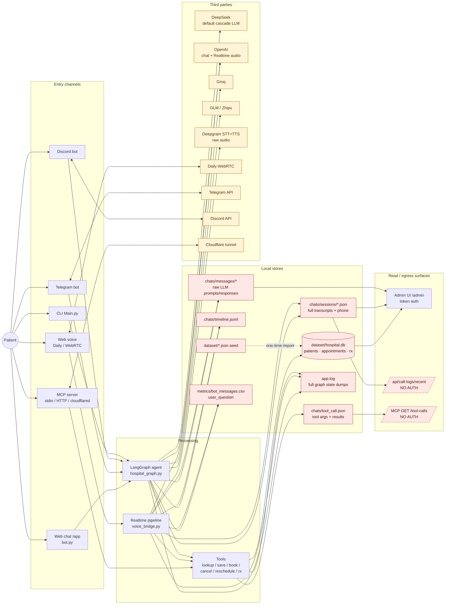

# PHI Data-Flow Map — DBC Care assistant

**HIPAA track, step 1 of N.** This document records *where Protected Health Information enters, moves through, is stored by, and leaves* the system as the code exists today (commit `5ff6708`, 2026-08-21). It is a map, not a fix list: every line cites the file that makes it true. Gaps noticed while mapping are collected at the end as input to step 2 (risk analysis).

> Seeded data from `MakeDataBase.py` is synthetic (fake names, TV-character doctors, invented medicines). The pipeline cannot tell synthetic from real rows, so the map treats all of it as PHI.

## 1. What counts as PHI here

| Data element | Where it originates | HIPAA identifier class |
|---|---|---|
| Patient name, phone, address, `patient_id` | `patients` table (`db_core.py:40-46`) | Names, phone numbers, geographic data, unique IDs |
| Appointment: doctor, department, time, status | `appointments` (`db_core.py:48-56`) | Dates of service + treatment context |
| Prescriptions: medicine name, timing | `prescriptions` (`db_core.py:58-64`) | Medication / clinical |
| Conversation transcripts (text) & voice audio | every channel | Free-text PHI |
| Telegram user id, Discord user id / channel id | `telegram_bot.py:104`, `discord_bot.py:110-117` | Device / account identifiers |
| `session_id` / `call_id` linked to `patient_id` | `chat_log_turns.py:99-108` | Linking key (becomes PHI once linked) |

Not present in the schema: DOB, email, insurance, SSN, clinical notes.

## 2. The map

Legend: red = store holding PHI · amber = data leaves the host · dashed red = reachable without authentication.

## 3. Entry channels — what comes in and what identifies the caller

| Channel | Entry point | Transport / intermediary | Identifiers captured | Caller auth |
|---|---|---|---|---|
| Web chat | `bot.py:588-620` (Pipecat FastAPI, `/app`, `/app-lite`) | HTTP, plain on local bind; no CORS middleware configured | client-supplied `session_id` (`log_routes.py:21`) | none |
| Web voice | `bot.py:436-441` Daily / WebRTC | audio via **Daily** | session id | none |
| Telegram | `telegram_bot.py:62-77,104` | **Telegram servers** see all text | `tg_<user_id>`, `chat_id`; phone asked in-chat (`:44,53`) | none |
| Discord | `discord_bot.py:99-117` | **Discord servers** see all text | `dc_<user_id>`, `discord_channel_id` in session `meta` | none |
| MCP (Cursor / Claude / ChatGPT) | `mcp_server.py:266-302` | stdio, or HTTP; **cloudflared** public URL per `MD/mcp-cloudflare.md:26` | none beyond tool args | **off by default**; `--oauth` is a demo provider that auto-approves (`mcp_demo_oauth.py:42-44`) |
| CLI | `Main.py:74,109-121` | local shell | fixed `usr_cli` | OS user |

Patient *identity verification* is conversational only: a phone match alone sets `verified=True` (`db_patients.py:271`, `tool_patient.py:59`), and the on-file name is returned to the caller to "confirm" (`tool_patient.py:131-142`). No DOB / PIN / OTP exists.

## 4. Processing — where PHI lives in memory and what it is sent with

* **LangGraph cascade** (`hospital_graph.py`): every turn replays the whole message history to the LLM, including prior tool results, so once `lookup_patient` runs, the patient's name/phone/address/appointments ride along in every later LLM call (`tool_patient.py:178-196`).
* **Realtime** (`voice_bridge.py`): raw microphone audio streams to OpenAI Realtime; tool calls come back and hit the same tools.
* **System prompts** are static (`hospital_agents.py:22-35`); they do not embed DB rows.
* **Full graph state is logged** at INFO to `app.log` at seven points in `hospital_graph.py:63,160,166,172,183,194,205` (`pformat(state)`), plus every tool logs its args (`tool_patient.py:36-42,206`, `tool_booking.py:37,196,249`, `tool_prescriptions.py:17`, `voice_bridge.py:306-493,632`).

### Tools (all return JSON strings that the LLM sees)

| Tool | Reads | Writes | PHI in returned JSON |
|---|---|---|---|
| `lookup_patient` `tool_patient.py:23-196` | patients, appointments, prescriptions (by phone) | call↔patient link in chat log (`:164-176`) | full record + `confirm_name_from_db` / `confirm_phone_from_db` + past doctors + active appt |
| `save_patient` `tool_patient.py:199-256` | patients | **patients** | created/updated record; on phone collision returns the *existing* person's name+id (`:226-234`) |
| `book_appointment` `tool_booking.py:29-183` | patients, doctors, slots | **patients, appointments**, synthetic transcript via `record_booking_chat` | patient record + appointment |
| `cancel_appointment` `tool_booking.py:191-216` | appointments by phone | **appointments.status** | patient record |
| `reschedule_appointment` `tool_booking.py:243+` | appointments | **appointments.time** | appointment |
| `get_prescriptions` `tool_prescriptions.py:10-31` | prescriptions | — | **medicine names + dosing** |
| `list_doctors` `tool_doctors.py:18+` | doctors, availability | — | none |

Every invocation (args ≤2000 ch, result ≤4000 ch) is appended to `chats/tool_call.json` (`chat_log_tools.py:41-103`, `mcp_server.py:84`).

## 5. Stores — where PHI is at rest

| Store | What PHI it holds | Written by | Retention | Encryption | Who can read |
|---|---|---|---|---|---|
| `dataset/hospital.db` (SQLite) | patients (name, phone, phone_digits, address), appointments, prescriptions | `db_*.py`; schema `db_core.py:33-88` | forever; `clear_table()` manual (`db_core.py:263-271`) | **none** (no PRAGMA key) | filesystem; Admin API; tools |
| `dataset/patients.json`, `appointments.json`, `prescriptions.json` | same, plaintext seed copy | `MakeDataBase.py`; imported once `db_core.py:207-260` | forever | none | filesystem |
| `chats/sessions/sess-*.json` | verbatim `user_input_text` / `bot_response_text`, `patient_id`, `phone`, `appointment_id`, `user_id`, channel ids | `chat_log_turns.py:37-51,99-108,187-198` | **none**; manual delete via Admin | none | Admin API; `GET /api/call-logs/recent` (no auth) |
| `chats/tool_call.json` | every tool's args + results (names, phones, addresses, rx) | `chat_log_tools.py:41-103`, `mcp_server.py:84` | last 5000 entries | none | filesystem; **MCP `GET /tool-calls` (no auth)** |
| `chats/timeline.jsonl` | user text ≤500 ch, bot text ≤800 ch per event | `chat_log_events.py:41-75` | **unbounded append** | none | filesystem |
| `chats/messages/<session>/Message*_passed.txt` / `_response.txt` | complete prompt incl. all prior turns + tool results; raw LLM output | `llm_message_dump.py:216-223`; enabled by `admin_settings.json:14 save_llm_messages=true` | none; bulk delete via Admin | none | Admin API (`/admin/api/llm-messages/*`) |
| `chats/chat-*.jsonl` (CLI legacy) | transcript | `Main.py:54-60` | none | none | filesystem |
| `app.log` | full graph state, tool args, transcripts — highest density | `bot.py:73-79` (loguru), `Main.py:28-34`, `Tools.py:7-11` | rotate 20 MB × 5 files (web); CLI truncates on start | none | filesystem |
| `metrics/bot_messages.csv` | `user_question` column (user utterance) + session id | `turn_metrics.py:42-64,89-103` | append forever | none | filesystem |
| `Records` (repo root) | two real-looking name + phone pairs | orphan, **tracked in git → pushed to GitHub** | — | — | anyone with repo access |
| `.admin_token_secret` | not PHI; gates Admin | `admin_routes.py:60-64` | — | mode 0664 | group/world readable |

## 6. Third parties — where PHI leaves the host

| Recipient | What is sent | Trigger | Retention / BAA controls in code |
|---|---|---|---|
| **DeepSeek** (`api.deepseek.com`) | full conversation + tool results | default `cascade_llm`/`cli_llm` (`admin_settings.json:4-5`, `Model.py:87-100`) | none |
| **OpenAI** chat (`gpt-4o-mini`) | full conversation + tool results | `Model.py:74-84` when selected | none (`store=False` absent) |
| **OpenAI Realtime** (`gpt-realtime`) | **raw patient audio** + instructions | voice in realtime mode (`bot.py:272-286`) | none |
| **Groq** (`llama-3.3-70b`) | full conversation | `Model.py:47-57`; `LLM_PROVIDER` default (`Model.py:120`) | none |
| **GLM / Zhipu** (`open.bigmodel.cn`, CN) | full conversation | `Model.py:60-71`; enabled (`admin_settings.json:24`) | none |
| **Deepgram** STT / TTS | raw audio in; reply text (names, appointments) out | cascade voice (`bot.py:155-169`) | none (no redaction flags) |
| **Daily** | WebRTC audio transport | voice (`bot.py:437`, `Dockerfile:1`) | none |
| **Telegram API** | all chat text | `telegram_bot.py` | vendor-controlled; no BAA available |
| **Discord API** | all chat text | `discord_bot.py` | vendor-controlled; no BAA available |
| **Cloudflare** (trycloudflare) | all MCP traffic incl. `/tool-calls` | `MD/mcp-cloudflare.md:26` | quick-tunnel; no contract |
| **Langfuse** tracing (`LANGFUSE_BASE_URL`; self-hosted docker by default) | LLM prompts/replies + tool args/results per turn | `tracing.py`, only when `LANGFUSE_*` keys set | `phi_redact` mask while `HIPAA_MODE=1` (`LANGFUSE_MASK_PHI=1`): phones/e-mails masked in all text, names masked in structured fields (tool args/results) but **not** inside free-text prompts/replies — so keep the instance on-host (or under BAA) |
| Google Gemini | none at runtime (key-check only, `test_keys.py:81-89`) | manual | — |
| Deepgram / GLM billing APIs | account metadata only (`admin_credits.py`) | Admin credits page | — |

No BAA, zero-data-retention, or data-residency setting exists anywhere in the code or config (repo-wide grep: `store=False`, `zdr`, `retention` → 0 hits).

## 7. Read & egress surfaces

| Surface | Returns | Auth |
|---|---|---|
| `GET /admin/api/patients?q=` | whole patient table | Admin token |
| `GET /admin/api/patients/{id}` | record + visits + **prescriptions** + all linked chats | Admin token |
| `GET /admin/api/chats/{session}` | full transcript | Admin token |
| `GET /admin/api/llm-messages/sessions[/{id}]` | raw LLM prompt/response dumps | Admin token |
| `GET /admin/api/appointments` | all appointments w/ patient names | Admin token |
| HTML pages `/admin/*`, static `/admin/static` | shells (data fetched via API) | **none server-side** (`admin_routes.py:141-177`) |
| **`GET /api/call-logs/recent`** | recent sessions incl. `patient_id` | **none** (`log_routes.py:84-86`) |
| **`POST /api/call-logs/event`** | writes text into any session id | **none** (`log_routes.py:64-75`) |
| **MCP `GET /tool-calls`** | tool args/results: names, phones, addresses | **none** (`mcp_server.py:244-257`); published via cloudflared |
| `GET /api/tools`, `/toollist` | schemas only | none (no PHI) |

Admin auth itself: default credentials `Admin`/`12345` (`admin_routes.py:51-52`), token = HMAC(username) with no expiry or revocation (`:70-76`), cookie without `Secure` (`:186-193`), no rate limit on login.

## 8. Deployment context

* `Dockerfile` → `dailyco/pipecat-base:latest`, copies `bot.py` only; `pcc-deploy.toml` → Pipecat Cloud (`agent-1x`, `min_agents=1`).
* No TLS configured in repo; HTTPS only where a vendor terminates it (Pipecat Cloud, Cloudflare).
* No rate limiting anywhere.

## 9. Gaps surfaced while mapping (input to step 2)

Ordered by exposure, not yet prioritised formally:

1. **PHI readable without authentication** — `GET /api/call-logs/recent`, MCP `GET /tool-calls` (and it is documented as a public Cloudflare URL), unauthenticated `POST /api/call-logs/event` lets anyone inject transcript text.
2. **`Records` file with name+phone pairs is committed and on GitHub.** Needs removal *and* history rewrite.
3. **`app.log` dumps full LangGraph state** (every transcript and tool result) at INFO, plus tool-level PHI logging.
4. **Four LLM vendors with no BAA path receive full PHI** — DeepSeek and GLM (CN endpoint) offer no BAA; OpenAI and Groq offer one but none is executed and no ZDR is configured; Telegram and Discord are not BAA-eligible channels.
5. **Voice audio → Deepgram and OpenAI Realtime** with no BAA / redaction configuration.
6. **No encryption at rest** for SQLite, chat logs, LLM dumps, metrics, `app.log`.
7. **No retention policy** — `chats/`, `timeline.jsonl`, `metrics`, LLM dumps grow forever; `save_llm_messages` is on.
8. **Admin auth** — default creds, non-expiring username-derived token, `Secure` flag missing, HTML pages unauthenticated, `.admin_token_secret` world-readable.
9. **Identity verification is phone-only and discloses the on-file name** before verification; `save_patient`/`book_appointment` reveal another person's name on phone collision; `cancel_appointment` works on phone alone.
10. **MCP OAuth is a demo provider** that auto-approves any client.
11. No audit trail of *who* accessed PHI (Admin reads are not logged), no rate limiting, no TLS in-repo.

## Next step

Step 2 — **Risk analysis & remediation plan**: score each gap above (likelihood × impact), decide the target architecture (which vendors stay under BAA, which channels are dropped or made non-PHI), and sequence fixes: stop-the-bleeding (unauth endpoints, `Records`, log scrubbing) → access control → encryption/retention → vendor contracts → audit logging → policies/training.
