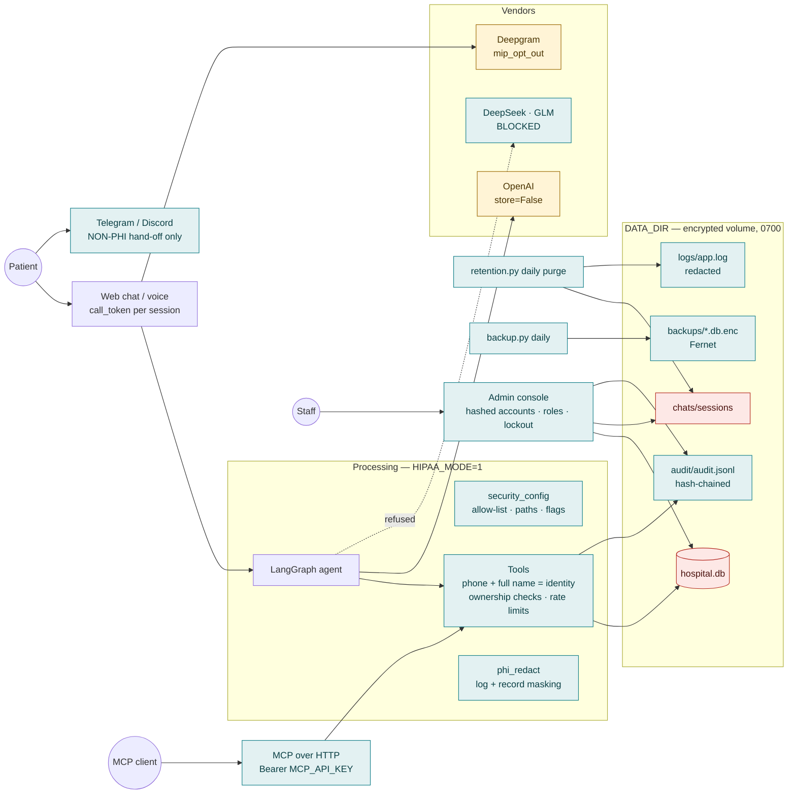

# Technical Remediation Report — DBC Care assistant

**HIPAA track, step 3.** Records what was changed in the code base to close the technical
findings of the [Security Risk Assessment](02-security-risk-assessment.md) (Phase 0 and the
code-level items of Phase 2), how each change was verified, what an operator must do to
turn the new controls on in a real deployment, and which risks remain open because they
need contracts, infrastructure, or policy rather than code.

| | |
|---|---|
| Baseline assessed | commit `5ff6708` (2026-08-21) |
| Work completed | 2026-08-21 — **uncommitted working tree**: 50 files changed, +3 413 / −407 lines, 8 new modules |
| Verification | `pytest`: **110 passed, 0 failed, 1 skipped** (MCP middleware test skips where the `mcp` package is absent); CLI smoke tests in §4 |
| Status | Ready for code review → commit → deployment hardening (§5) |

## 1. Architecture after remediation

## 2. What changed — by finding

Risk IDs refer to the register in step 2. "Before → after" is the rating expected once the
operator steps in §5 are done.

### Access control (R-01, R-06, R-08, R-09, R-20 — all Critical/High → Low)

| Change | Files | Effect |
|---|---|---|
| `GET /api/call-logs/recent` now requires an authenticated admin session and is audited | `log_routes.py` | PHI session list no longer public |
| `/api/call-logs/start` issues a per-call `call_token` (HMAC of `call_id`); `/event` and `/end` refuse without it; start/event are rate-limited per IP | `log_routes.py`, `client/app.js`, `client-lite/app.js` | nobody can inject transcript text into another session |
| MCP `GET /tool-calls` **removed**; HTTP/SSE transports **refuse to start without `MCP_API_KEY`**; bearer middleware on every route except `/health`; denied attempts audited | `mcp_server.py` | tool args/results no longer reachable unauthenticated |
| Demo OAuth provider refused while `HIPAA_MODE=1`; `--allow-tunnel` default off; docs rewritten (no quick tunnels, no "No Authentication") | `mcp_server.py`, `MD/mcp-cloudflare.md` | any-client auto-approval removed from the PHI path |
| Admin auth rewritten: scrypt-hashed per-user accounts with `admin`/`viewer` roles (`admin_users.json`, 0600), `manage_admin.py` CLI, weak/default passwords refused in HIPAA mode, server-side sessions (30 min idle / 12 h absolute, revoked on logout), signed session ids, 5-failure lockout + per-IP login rate limit, `Secure`/`HttpOnly`/`SameSite=Strict` cookie, HTML pages redirect to login server-side, write endpoints need `admin` role | `admin_auth.py` (new), `rate_limit.py` (new), `admin_routes.py` | default `Admin/12345` and the forever-token are gone |
| CORS locked to `ALLOWED_ORIGINS` (was `*`); security headers (`nosniff`, `DENY` framing, no-referrer, HSTS when secure cookies are on, `no-store` on APIs) | `bot.py`, `security_config.py` | cross-site access to the API closed |
| File permissions: `umask 077`, 0600 on `.env`, secrets, DB, logs; 0700 on every PHI directory — applied at every start-up | `security_config.harden_permissions()` called from `bot.py`, `Main.py`, `telegram_bot.py`, `discord_bot.py` | R-17 → Low |

### Identity verification (R-10 High → Medium)

| Change | Files |
|---|---|
| Identity = **phone AND full name supplied by the caller**. Phone alone returns `needs_name` with **no record**; wrong name returns `name_mismatch` with **no hint**; name-only lookups never reveal the on-file phone; `patient_id` alone requires the phone as well | `db_patients._resolve_patient`, `tool_patient.lookup_patient` |
| `save_patient` / `book_appointment` phone collisions return a generic `phone_conflict` message — the other person's name and id are no longer disclosed | `tool_patient.py`, `tool_booking.py` |
| `cancel_appointment` / `reschedule_appointment` require the caller's phone; with an `appointment_id` the phone must belong to that appointment (`not_owner` otherwise); by phone alone they also require the full name | `tool_booking._authorize_appointment` |
| `get_prescriptions` requires phone **and** full name (patient id alone refused) | `tool_prescriptions.py` |
| Per-session limits: 8 lookups / 10 min, 3 name mismatches / 10 min then `locked` (front-desk hand-off) | `tool_patient.py` |
| Agent prompts updated to the new flow ("And your full name, please?"), never reading DB values back to the caller | `hospital_agents.py` |

### Vendor / channel controls (R-03, R-04, R-05, R-21)

| Change | Files | Effect |
|---|---|---|
| `HIPAA_MODE` (default **on**) + `PHI_ALLOWED_PROVIDERS` allow-list (default `openai`); DeepSeek and GLM can **never** be allow-listed; `Model._init_model` raises for blocked providers; admin settings resolve to an allowed LLM and show blocked providers as *blocked: no BAA*; Realtime only when OpenAI is allowed | `security_config.py`, `Model.py`, `service_settings.py`, `bot.py` | PHI cannot be sent to a non-BAA LLM by configuration mistake. **Contract still required** (§5) |
| OpenAI chat: `store=False`; Deepgram STT/TTS: `mip_opt_out=True` | `Model.py`, `bot.py` | no vendor-side retention/training beyond abuse logs |
| Telegram and Discord are **non-PHI hand-off channels** in HIPAA mode: the agent never runs, no transcript is logged, the user is pointed to `WEB_APP_URL` / front desk | `telegram_bot.py`, `discord_bot.py`, `security_config.py` | R-05 Critical → Low (channels keep existing without carrying PHI) |
| Google key is unused at runtime; remove from `.env` (operator step) | — | — |

### PHI minimisation in logs and records (R-12 High → Low)

| Change | Files |
|---|---|
| Seven full-state `pformat(state)` dumps replaced by message counts/roles | `hospital_graph.py` |
| Tool loggers log masked phone (`********10`), never names; voice/interrupt loggers log lengths instead of transcripts; Realtime tool args redacted | `tool_*.py`, `voice_bridge.py`, `interrupt_trace.py` |
| Global safety net: a stdlib `logging` filter + loguru patcher masks phone-like digit runs and e-mails in every log line | `phi_redact.install_log_redaction()` from `bot.py`, `Main.py`, `Tools.py` |
| `chats/tool_call.json` stores redacted args/results in HIPAA mode (ids kept, phones masked, names masked, addresses removed) | `chat_log_tools.py` |
| Raw LLM prompt/response dumps (`chats/messages/`) are off with real data: allowed while `SYNTHETIC_DATA_ONLY=1` (prompt/QA work) or with the explicit `LLM_QA_DUMPS=1` (admin-only, audited reads, purged after `RETAIN_LLM_DUMPS_DAYS`=7); otherwise the setting is forced off and the admin PUT is rejected. **Conversation transcripts, tool calls and timings are still stored and reviewable in Admin** — only the per-turn full-prompt copies are restricted | `llm_message_dump.py`, `service_settings.py`, `admin_routes.py`, `security_config.py` |
| Metrics CSV keeps only `[N chars]` instead of the user utterance | `turn_metrics.py` |
| Telegram/Discord failure logs no longer include platform user ids | `telegram_bot.py`, `discord_bot.py` |

### Audit, retention, backup, data location (R-11, R-13, R-14, R-16)

| Change | Files |
|---|---|
| **Audit log** `audit/audit.jsonl`: append-only, 0600, SHA-256 hash chain (`verify_chain()`), multi-process safe (exclusive file lock per append — web app, MCP server and bots share one file), never stores raw identifiers (patient_id + keyed phone hash). Events: admin login/logout/fail, every admin PHI read (patients, patient detail, chats, appointments, LLM dumps), settings changes, deletes, every tool call outcome (lookup/save/book/cancel/reschedule/prescriptions incl. `name_mismatch`, `not_owner`, `rate_limited`), MCP auth denials, retention purges, backups. `GET /admin/api/audit` (admin role) lists records + chain status | `audit_log.py` (new), call sites across `admin_routes.py`, `log_routes.py`, `tool_*.py`, `mcp_server.py` |
| **Retention**: policy via env (`RETAIN_*_DAYS`, defaults sessions 90 · tool calls 30 · timeline 30 · LLM dumps 7 · metrics 90 · backups 35); best-effort overwrite-then-unlink; `python retention.py [--dry-run]`; daily in-process scheduler started by `bot.py` | `retention.py` (new) |
| **Backups**: SQLite online-backup snapshot, Fernet-encrypted when `BACKUP_ENC_KEY` is set, 0600, rotation (`BACKUP_KEEP_LAST`), `verify`/`restore` with `PRAGMA integrity_check`; daily scheduler | `backup.py` (new) |
| **`DATA_DIR`**: one root for `dataset/`, `chats/`, `metrics/`, `logs/`, `audit/`, `backups/`, secrets — place it on an encrypted volume; legacy in-repo paths remain the default when unset | `security_config.py`, `db_core.py`, `chat_log_core.py`, `llm_message_dump.py`, `turn_metrics.py` |

### Source control & build (R-02, R-18)

| Change | Files |
|---|---|
| `Records` (name + phone pairs) deleted from the working tree and ignored; **history rewrite script prepared** — `scripts/purge_records_history.sh` (git-filter-repo + force-push). Not executed: it rewrites public history and must be run deliberately by the repo owner | `scripts/purge_records_history.sh`, `.gitignore` |
| `.gitignore` covers `admin_users.json`, `audit/`, `backups/`, `data/`, `*.enc`, DB files | `.gitignore` |
| `requirements.lock` (126 pinned packages) generated for reproducible installs / `pip-audit` | `requirements.lock` |
| Dockerfile: copies the whole app (was `bot.py` only), runs as uid 1000, `HIPAA_MODE=1`, `DATA_DIR=/data` volume | `Dockerfile` |
| `.env.example`: default-credential hint removed; HIPAA section documents every new variable | `.env.example` |

## 3. New modules

| Module | Purpose |
|---|---|
| `security_config.py` | HIPAA mode, data paths, secrets, provider allow-list, non-PHI channels, CORS origins, cookie flags, permission hardening, start-up warnings |
| `phi_redact.py` | `mask_phone`, `mask_name`, `redact_text`, `redact_obj`, log redaction filter/patcher |
| `audit_log.py` | hash-chained audit trail, `verify_chain`, `recent` |
| `admin_auth.py` | accounts, scrypt hashes, roles, sessions, lockout |
| `rate_limit.py` | sliding-window limiter + lockout counter |
| `retention.py` | purge policy + scheduler + CLI |
| `backup.py` | encrypted backups + restore + scheduler + CLI |
| `manage_admin.py` | account management CLI |
| `tests/test_security.py` | 15 tests covering every control above |

## 4. Verification

| Check | Result |
|---|---|
| Full test suite (`.venv`) | 108 passed, 0 failed, 1 skipped |
| New `tests/test_security.py` | allow-list, blocked provider init, settings resolution, non-PHI channels, redaction, log filter, audit chain + tamper detection + 0600, weak-password refusal (503), lockout (423) + session revoke + forged token, HTTP role gating (303 redirect, 401, 403, 400 on dumps) + audit records, identity non-disclosure (phone-only, wrong name, id-only, collisions, prescriptions, cancel), mismatch lockout, retention dry-run/purge, encrypted backup create/verify/restore, MCP bearer middleware |
| Updated legacy tests | call-log lifecycle (token required, `recent` 401 → 200 after login), booking journey (`not_owner`, phone+name for cancel), tools flow |
| `python mcp_server.py --list-tools` (conda `hosmanag`) | 7 tools registered |
| `mcp_server.py --transport streamable-http` without `MCP_API_KEY` | refuses: *"HTTP/SSE MCP transports require authentication…"* |
| `--oauth` with `HIPAA_MODE=1` | refuses: *"demo OAuth provider … is refused while HIPAA_MODE is on"* |
| `retention.py --dry-run` | prints policy and counts, deletes nothing |
| `backup.py keygen → create → list → verify` (temp `DATA_DIR`) | `.db.enc` written 0600, verify `ok` |
| `import bot` with `DATA_DIR=<tmp>` | all PHI directories created 0700; `PIPECAT_ALLOWED_ORIGINS` set to the allow-list |
| Legacy tests run with `HIPAA_MODE=0` (conftest) so dev behaviour stays covered; security tests opt in to `HIPAA_MODE=1` | — |

## 4b. Development posture vs. go-live gate

The team keeps building with DeepSeek + Deepgram on synthetic data while the BAAs are negotiated,
and will swap to OpenAI/Azure before any real patient. That is supported explicitly:

| Posture | Env | What is on | What is relaxed |
|---|---|---|---|
| **Development (now)** | `HIPAA_MODE=1` + `SYNTHETIC_DATA_ONLY=1` | every control: auth, audit, redaction, retention, backups, permissions, identity rules | vendor allow-list admits DeepSeek/GLM/Groq/OpenAI; Telegram/Discord carry (synthetic) PHI so they can be tested |
| **Production** | `HIPAA_MODE=1`, flag removed, `PHI_ALLOWED_PROVIDERS=openai` | everything | nothing — non-BAA vendors/channels are refused |
| Throw-away experiments | `HIPAA_MODE=0` | nothing | everything (never with real data) |

`python go_live_check.py` is the gate: it **fails** while `SYNTHETIC_DATA_ONLY` is set, while any
DeepSeek/GLM/Google key is present, while Telegram/Discord may carry PHI, while `DATA_DIR`,
secure cookies, explicit origins, hashed admin accounts, `BACKUP_ENC_KEY`, MCP auth, or the
audit chain are missing — and it requires `CONFIRMED_BAAS=openai,deepgram[,…]` to be set once the
signed agreements are in hand. Covered by `tests/test_security.py`.

## 5. Operator actions required (before real PHI)

1. **Review & commit** this change set (nothing is committed yet); then run `scripts/purge_records_history.sh` to purge `Records` from git history (force-push; collaborators re-clone) and record the incident per step 2 §8.
2. **Create admin accounts**: `python manage_admin.py add <user>` (and `--role viewer` for read-only staff). Remove `ADMIN_PASS` from `.env`.
3. **Set secrets**: `ADMIN_TOKEN_SECRET` (64 hex), `MCP_API_KEY` (if remote MCP is used), `BACKUP_ENC_KEY` (`python backup.py keygen`, store the key outside `DATA_DIR`).
4. **`DATA_DIR`** on an encrypted volume (LUKS / cloud-encrypted disk) and `chmod 700`; copy `dataset/hospital.db` there once; set `ALLOWED_ORIGINS`, `WEB_APP_URL`, `COOKIE_SECURE=1`.
5. **TLS** in front of the web app and MCP (reverse proxy or platform load balancer); keep `HIPAA_MODE=1`.
6. **Vendors**: execute BAAs and only then set `PHI_ALLOWED_PROVIDERS` (OpenAI ZDR agreement; Deepgram enterprise; Daily/Pipecat Cloud HIPAA mode; Groq optional). Remove `DEEPSEEK_API_KEY`, `GLM_API_KEY`, `GOOGLE_API_KEY` from `.env`.
7. **Off-host copy** of `backups/` and `audit/` (the audit log is never purged locally; rotate it to retained storage).
8. Existing plaintext history on this workstation (`app.log`, `chats/`, `metrics/`) predates redaction — run `python retention.py` and securely delete what the policy allows, or move everything into the encrypted `DATA_DIR`.

## 6. Residual risk after this step

| Risk | Before | After code | After operator steps (§5) | Notes |
|---|---|---|---|---|
| R-01 unauth PHI endpoints | Critical | **Low** | Low | closed in code |
| R-02 `Records` in public repo | High | Medium (file removed) | **Low** after history purge | needs force-push |
| R-03 / R-04 vendors without BAA | Critical | Medium (non-BAA vendors refused; BAA-capable ones still need contracts) | **Low** | contracts |
| R-05 Telegram/Discord | Critical | **Low** | Low | non-PHI hand-off |
| R-06 admin auth | Critical | **Low** | Low | accounts must be created |
| R-07 TLS / cookies | High | Medium (Secure cookies, HSTS ready) | **Low** | TLS termination |
| R-08 / R-20 MCP | Critical | **Low** | Low | bearer key + no demo OAuth |
| R-09 transcript injection | High | **Low** | Low | call tokens |
| R-10 identity | High | **Medium** | Medium | inherent limit of chat-based proofing; OTP would reach Low |
| R-11 encryption at rest | High | Medium (single dir, 0700, encrypted backups) | **Low** | encrypted volume for `DATA_DIR` |
| R-12 PHI in logs | High | **Low** | Low | redaction + dumps off |
| R-13 retention | High | **Low** | Low | scheduler on |
| R-14 audit | High | **Low** | Low | hash-chained log |
| R-15 unique IDs / roles | High | **Low** | Low | per-user accounts |
| R-16 backups | High | **Low** | Low | daily encrypted + off-host copy |
| R-17 file perms | Medium | **Low** | Low | — |
| R-18 dependencies | Medium | Medium (lockfile) | Low with `pip-audit` in CI | — |
| R-21 hosting BAA | High | High | **Low** | contract |
| R-22 / R-23 policies, IR, training | High | High | — | administrative track (step 4) |

## Next step

**Step 4 — administrative & contractual track**: BAAs (OpenAI ZDR, Deepgram, Daily/Pipecat Cloud, hosting), Security/Privacy Officer designation, policy set (access control, incident response & breach notification, retention/disposal, workstation, sanctions, contingency), workforce training, and the incident record for `Records`. Code-side follow-ups worth scheduling: OTP-to-phone identity proofing, `pip-audit` in CI, and moving the audit log to WORM/off-host storage.
