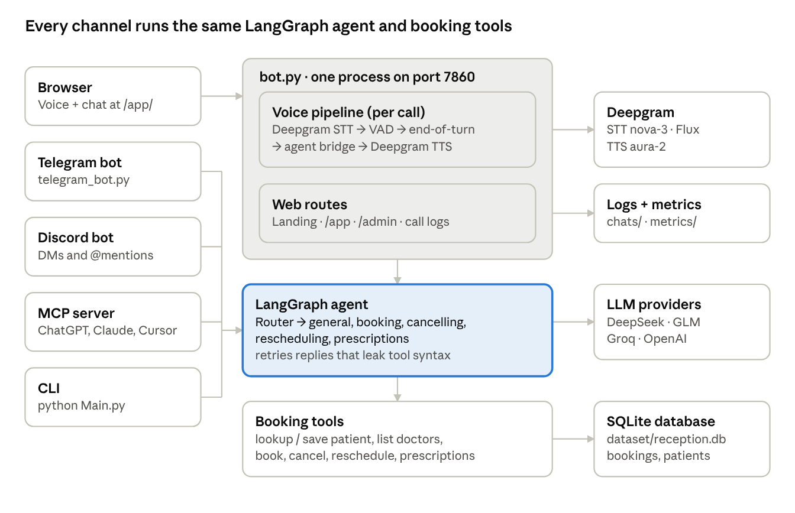
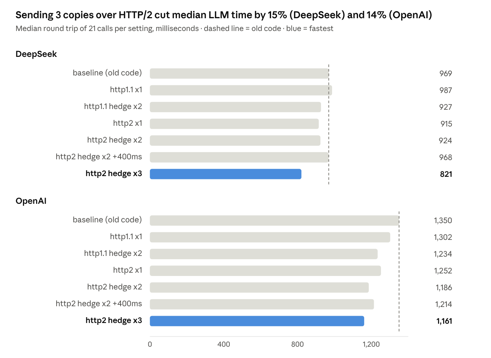

# ReceptionAi — how it works, start to end

Last updated: 30 Oct 2026

## Overview

ReceptionAi is an AI front desk that answers callers by voice or text and books, moves and cancels appointments in a real database. It runs as one Python process (`bot.py`) and serves a landing page, a voice/chat app and an admin panel from `http://localhost:7860`.

What a caller can do:

- Book an appointment with a doctor (or a table / room, depending on the industry), checked against real availability
- Cancel or reschedule an existing booking, found by phone number
- Ask general questions about the business
- Ask about their prescriptions (hospital only)

Where callers reach it: browser voice calls, browser chat, OpenAI Realtime voice, Telegram, Discord, an MCP server (ChatGPT / Claude Desktop / Cursor) and a terminal CLI. Every channel uses the same LangGraph agent and the same booking tools, so behaviour is identical everywhere.

The same code serves three industries — hospital / clinic (default), restaurant and hotel — by swapping the words it uses (doctor/table/room, patient/guest, appointment/reservation/stay).

## Running it

Run `./start.sh` from the project folder. It picks a Python that has Pipecat installed (`.venv`, then the `hosmanag` conda env), builds the landing page if `web/out/` is missing, and starts `bot.py` on port 7860.

| URL | What it is |
| --- | --- |
| `http://localhost:7860/` | Landing page ("Request a call" opens the voice app and dials) |
| `http://localhost:7860/app/` | Voice + chat app (`/app/?call=1` dials immediately) |
| `http://localhost:7860/app-lite/` | Lighter version of the app |
| `http://localhost:7860/admin/` | Admin panel — not linked from the landing page |

Admin login defaults to **Admin / 12345** (admin\_routes.py). Set `ADMIN_USER` and `ADMIN_PASS` in `.env` before anyone else can reach the server.

Keys live in `.env` (copy `.env.example`): `DEEPGRAM_API_KEY` for speech, plus at least one LLM key — `DEEPSEEK_API_KEY`, `GLM_API_KEY`, `GROQ_API_KEY` or `OPENAI_API_KEY`. Telegram and Discord need their bot tokens.

Other commands:

- `./start.sh --rebuild` — rebuild the landing page after editing `web/`
- `python Main.py` — terminal chat
- `python mcp_server.py` — MCP tools for Claude Desktop / Cursor
- `python telegram_bot.py`, `python discord_bot.py` — messaging bots
- `python MakeDataBase.py --clear-all` then `--days 3 --per-doctor 4` — reset and reseed demo data
- `python -m pytest` — 160 tests

## Architecture

Browser calls go through `bot.py`'s voice pipeline; Telegram, Discord, MCP and the CLI run as their own processes but load the same agent. The exception is OpenAI Realtime mode, where OpenAI's model talks to the caller directly and calls the booking tools itself, skipping the LangGraph agent.

## A voice call, start to finish

A cascade call turns the caller's speech into text, runs the agent, and speaks the reply — about 2 seconds from the caller stopping to hearing the answer (median, see Metrics).

1. **Dial.** The caller presses *Request a call* on the landing page, or *Call* in `/app/`. The browser opens a WebRTC audio link to `bot.py` and posts `/api/call-logs/start`, which creates `chats/sessions/sess-<id>.json`.
2. **Pipeline built.** `run_bot` reads the Admin settings (end-of-turn method, silence, speculation) and builds: microphone → Deepgram STT → transcript tap → user aggregator (Silero VAD + turn strategies) → interrupt trace → LangGraph processor → Deepgram TTS → speaker.
3. **Listening.** Deepgram `nova-3` streams interim and final transcripts, boosted with month names and booking words so dates and phone numbers come out right. Silero VAD marks when speech starts and stops.
4. **End of turn.** The chosen method decides the caller has finished (next section). The aggregator then hands the full utterance to the agent.
5. **Agent turn.** `voice_bridge.py` runs the LangGraph agent in a worker thread on the call's conversation thread. The router picks a specialist, which may call tools (look up the patient, list doctors, book). Replies that leak tool syntax are retried up to twice.
6. **Reply.** The whole reply goes to TTS as one utterance (Deepgram `aura-2-thalia-en` by default), so a multi-sentence answer is not cut in half. The same text is sent to the chat panel.
7. **Logging.** The browser posts each turn's events (`/api/call-logs/event`), the server records tool calls and the agent name, `turn_metrics.py` writes a latency row, and `chats/timeline.jsonl` records interruptions.
8. **Hang up.** `/api/call-logs/end` stamps the session's end time. The conversation memory stays, so calling again from the same browser window continues where it left off.

If the caller talks while the bot is busy, the words are queued and answered next rather than dropped. While the bot is speaking, the mic is muted so the bot's own voice from the speakers cannot interrupt it.

## Turn-taking: knowing when the caller has finished

Silero VAD always runs and detects speech; the **end-of-turn method** chosen in Admin → Settings → Voice turn-taking decides when the caller is done (turn\_detection.py).

VAD settings: speech must be 70% likely (`confidence 0.7`), last 0.2s to count (`start_secs`), and be louder than `min_volume 0.6`, so coughs and room noise don't open a turn.

| Method | How it decides | Cost / needs | Status here |
| --- | --- | --- | --- |
| Silence timeout (default) | Ends the turn after *Silence before reply* seconds of silence (0.1–3.0s, default 0.2s) | Nothing extra | Ready |
| Smart Turn v3 | An audio model checks intonation at each 0.2s pause and says finished / not yet | Runs on CPU, model ships with Pipecat | Ready |
| VAP | Predicts who speaks next; a predicted switch to the bot ends the turn | PyTorch + `python setup_vap.py` | Not installed (greyed out) |
| Deepgram Flux | Deepgram's speech-to-text decides the end of turn itself | Deepgram Flux usage | Ready |

The model methods give up after *Max pause for model methods* (0.3–5.0s, default 2.0s), so a caller who has really finished never waits long.

**Voice speculative** (off by default) starts the agent at the first pause, before the turn is confirmed (speculation.py):

- The guess runs on a copy of the conversation. If the final words match, its reply is used and the copy becomes the conversation; otherwise it is discarded and history is untouched.
- `book_appointment`, `cancel_appointment`, `reschedule_appointment` and `save_patient` wait until the turn is confirmed, so a wrong guess can never change a booking.
- No guesses while the caller is reading out a phone number.
- Trade-off: faster replies, but every discarded guess is an extra LLM call.

Safeguards that apply to every method:

- **Mic muted while the bot speaks**, and always unmuted if the reply is cut off — earlier the mic could stay muted for the rest of the call (user\_mute\_safe.py).
- **Soft-speech start**: if VAD misses quiet speech but Deepgram returns a final transcript, the turn still starts (soft\_speech\_turn\_start.py).
- **No new turn while the bot is busy or speaking**, so a late transcript can't cut a reply in half.
- **Phone-number buffering**: when the bot has asked for a number, digit fragments are held for 1.15s and joined, so "98765" + "43210" becomes one number.

## Speech-to-text and text-to-speech

**Speech-to-text (STT):** Deepgram `nova-3`, streaming (bot.py, `build_cascade_pipeline`). Settings: interim results on, smart formatting, punctuation, and "keyterms" (month names, booking words, doctor names) so dates and numbers come out right. Words arrive while the caller is still talking, so the final transcript is ready about 50 ms (median) after they stop. With the *Deepgram Flux* turn method, Flux replaces nova-3 and also decides the end of turn.

**Text-to-speech (TTS):** Deepgram `aura-2-thalia-en` (change with `DEEPGRAM_VOICE` or Admin). The whole reply is sent as one utterance so a multi-sentence answer is not cut. Audio starts playing about 0.35 s after the reply text is ready.

**Answer generation:** the LangGraph agent (see *The agent*) with the LLM chosen in Admin (DeepSeek by default for voice). The reply is generated in full, then spoken; it is not streamed sentence by sentence.

**OpenAI Realtime mode** skips all three: one OpenAI model hears, answers and speaks.

## The agent

Every message goes through one LangGraph graph (reception\_graph.py): a router picks one specialist, the specialist answers (calling tools if needed), and the turn ends. Conversation history is kept per thread in memory (`InMemorySaver`), so it resets when the server restarts.

The router uses rules first and the LLM second (reception\_routing.py): it stays with the current specialist on short replies like "yes" or a phone number, sends symptoms ("toothache") to booking, and asks the LLM only when unsure.

| Specialist | Handles | Tools |
| --- | --- | --- |
| general | Greetings, questions about the business | none |
| booking | New appointments | lookup\_patient, save\_patient, list\_doctors, book\_appointment, cancel\_appointment, reschedule\_appointment |
| cancelling | Cancelling a booking | lookup\_patient, cancel\_appointment, book\_appointment, reschedule\_appointment, list\_doctors |
| rescheduling | Moving a booking | lookup\_patient, reschedule\_appointment, cancel\_appointment, book\_appointment, list\_doctors |
| prescriptions | Medicines and dosage (hospital only) | get\_prescriptions |

Booking rules enforced by the tools, not the LLM (db\_appointments.py): slots are 10 minutes, between 09:00 and 17:00; the doctor must be available; no clashes. A refused slot comes back with the reason and nearby free times to offer.

LLM providers (Model.py): DeepSeek (`deepseek-chat`, voice default), Zhipu GLM (`glm-4-flash`), Groq (`llama-3.3-70b-versatile`, CLI default) and OpenAI. Each can be switched or disabled in Admin. Calls share one keep-alive HTTP client and can optionally be "hedged" — sent 2–3 times with the first answer used (llm\_transport.py).

Recovery (agent\_turn.py): DeepSeek sometimes writes tool calls as text, claims a tool is missing, or says "someone will call you". The turn detects this and nudges the model up to two more times; if that fails the caller hears a safe clarifying question instead of garbage.

## How typed chat reaches the agent

Browser chat has no separate endpoint. Typed text and speech share one WebRTC connection to `bot.py`:

1. The chat box calls `client.sendText(text)` (client/app.js, composer submit handler).
2. Pipecat turns it into an `LLMContextFrame`, the same frame a finished spoken turn produces.
3. `process_frame` in voice\_bridge.py extracts the user's text, drops duplicates, buffers phone-number fragments, and queues the text if the bot is busy.
4. `_run_one_turn` runs `run_turn()` (agent\_turn.py) in a worker thread, which calls the LangGraph graph (`app.invoke`).
5. The reply goes back to the chat panel. It is also spoken only if a voice call is active.

The CLI (`Main.py`), Telegram and Discord bots call the same `run_turn` / graph directly.

## Booking an appointment, step by step

The `booking` specialist drives this; every rule is checked in code by the tools, so the LLM cannot book an invalid slot.

1. **Phone first.** The agent asks for the phone number and calls `lookup_patient(phone=...)` (tool\_patient.py). Phone is the key because names are not unique.
2. **Confirm identity.** Returning patient: the agent asks "Are you <name on file>?" and calls `lookup_patient` again with the name. New patient: it asks for the full name and calls `save_patient`.
3. **Choose doctor.** `list_doctors` (tool\_doctors.py) lists doctors by department; a symptom like "toothache" is mapped to the right department.
4. **Book.** `book_appointment(patient_name, doctor, time, phone)` (tool\_booking.py):
   - checks the doctor exists and turns "tomorrow at 10" into a real date and time;
   - finds or creates the patient and checks the name matches the phone;
   - checks the patient has no other active booking (if they do, it returns guidance to reschedule instead);
   - `check_slot_bookable` (db\_appointments.py): 10-minute slots, 09:00–17:00, doctor not on a break, no clash;
   - inserts the appointment, re-checks for a race with another booking, and links it to the call log.
5. **Refusal.** If the slot is not free, the tool returns the reason plus nearby free times, and the agent offers those.

## Cancelling and rescheduling

- **Cancel:** `cancel_appointment(appointment_id=... or phone=...)`. With a phone number it finds the patient's single active booking. It sets the status to `CANCELLED` (the row is kept, not deleted). Cancelling twice just reports it is already cancelled.
- **Reschedule:** `reschedule_appointment` finds the booking the same way, runs the same slot checks on the new time, and moves it.
- The agent always confirms the patient by phone + name (same as booking) before changing anything.
- In voice-speculative mode these write tools wait until the caller's turn is confirmed, so a wrong guess never changes a booking.

## Other channels

All channels share the same agent, tools and database; only the way messages arrive differs.

| Channel | Start with | How it works |
| --- | --- | --- |
| Browser chat | `/app/` (type instead of calling) | Text goes straight to the agent; replies stream into the chat panel |
| OpenAI Realtime | Mode dropdown in `/app/`, or Admin default | OpenAI's speech-to-speech model hears and speaks directly, decides end of turn itself (semantic), and calls the same booking tools. Faster (\~0.45s median to first audio) but bypasses the LangGraph agent and this project's turn-taking settings |
| Telegram | `python telegram_bot.py` + `TELEGRAM_BOT_TOKEN` | Polls Telegram; each chat is its own conversation thread |
| Discord | `python discord_bot.py` + `DISCORD_BOT_TOKEN` | Replies to DMs and mentions; a lock file stops two copies running |
| MCP server | `python mcp_server.py` (local) or `--transport streamable-http` + Cloudflare tunnel | Exposes the booking tools to ChatGPT, Claude Desktop or Cursor |
| CLI | `python Main.py` | Terminal chat for testing the agent without audio |

Step-by-step guides for each are in this folder ([README](README.md)).

## Data and industries

Bookings live in one SQLite file, `dataset/reception.db` (db\_core.py). Most of what is in it now is generated demo data.

| Table | Rows now | Holds |
| --- | --- | --- |
| doctors | 102 | Name, department |
| doctor\_unavailable | 102 | Blocked times per day (currently lunch breaks) |
| patients | 15,003 | Name, phone, address |
| appointments | 15,005 | Patient, doctor, department, time, status |
| prescriptions | 4,284 | Medicine and timing per patient (hospital) |

Patients are found by phone number, with or without the country code. `MakeDataBase.py` creates the demo doctors, patients and bookings, and also writes demo chat sessions so the Admin pages have content.

Industry profiles (industry\_profile.py) change the words, not the code:

| Industry | Resource | Customer | Booking | Grouped by |
| --- | --- | --- | --- | --- |
| Hospital / Clinic (default) | doctor | patient | appointment | department |
| Restaurant | table | guest | reservation | seating area |
| Hotel | room | guest | stay | room type |

Switch in Admin → Settings → Business, or with `INDUSTRY=restaurant` in `.env`. Prescriptions are only offered for hospitals.

## Admin panel

`/admin/` controls how the assistant behaves and lets staff see its bookings and conversations. Settings are saved to `admin_settings.json` and apply on the next call or message.

| Page | What it shows or controls |
| --- | --- |
| Settings | Industry and business name; LLM for voice and for CLI; voice mode (cascade or Realtime); Deepgram voice and model names; cost controls (turn each provider on or off); voice turn-taking; debug options |
| Settings → Response timing | Average time to first reply text and first audio across real sessions (see Metrics) |
| Settings → Credits | Remaining balance for each provider, where the provider reports it |
| Appointments | All bookings, filterable |
| Patients / Patient | Patient list; one patient's details, bookings and linked conversations |
| Doctors / Doctor | Doctor list; one doctor's schedule |
| Messages | Every saved conversation, turn by turn, with the agent that answered; and, when *Save LLM messages* is on, the exact text sent to and returned by the LLM |

Two debug switches: **Debugging mode** shows send / first-text / first-audio times on each chat bubble; **Save LLM messages** writes every model call under `chats/messages/<session>/`.

## Metrics

A voice caller hears the first word of a reply about **2.0 seconds** after they stop speaking (median, cascade), and 1 in 10 replies takes over 3.2 seconds. Most of that time is the LLM.

### Why the Admin page showed counts but no metrics

The Response timing panel showed "359 sessions · 1902 turns · 289 users" with empty averages. Three problems, all fixed on 2026-10-30:

1. **The latency numbers were thrown away.** The browser measures each reply and sends `latency_ms`, but the server's event model (log\_routes.py) had no `latency_ms` field, so it was silently dropped. None of the 359 sessions had a latency value. Fixed: the field is kept, and older turns are estimated from the timestamps they did keep.
2. **Most sessions were demo data.** 274 of the 359 were fake conversations written by `MakeDataBase.py`. They are now excluded. The real figures are **85 sessions · 532 turns · 15 users** (62 voice calls, 9 Discord, 7 CLI, 3 Realtime, 3 Telegram, 1 other), 2026-07-17 to 2026-10-30.
3. **The server's latency log stopped on 2026-07-22.** `turn_metrics.py` only saved a row after seeing the LLM's text frames, and the voice bridge stopped sending those to fix duplicate chat bubbles. Fixed: it now counts the reply when it is handed to text-to-speech.

### Where metrics are recorded

| Source | File | Covers |
| --- | --- | --- |
| Browser, per turn | `chats/sessions/*.json` → `client_timings` | Time to first reply text and first audio, as the caller saw it |
| Server, per reply | `metrics/bot_messages.csv` | STT, LLM first token, full reply, TTS start, first audio, audio end (ms) |
| Interruptions | `chats/timeline.jsonl` | Turn start/stop, barge-ins, queued speech, with text |
| LLM calls | `chats/messages/<session>/` | Exact prompts and responses (when *Save LLM messages* is on) |
| Per-call settings | `chats/messages/<session>/` runtime meta | VAD timing, turn method, speculation used |
| Per LLM call T1–T4 | `metrics/llm_calls.csv` | Request sent, first byte, first token, last token per call |
| LLM speed test | `metrics/llm_bench.csv` | Round-trip time per provider and connection setting |

### Current numbers

| Measure | Median | 90th percentile | Turns | Source |
| --- | --- | --- | --- | --- |
| Cascade: caller stops → first audio | 1,967 ms | 3,218 ms | 238 | server, Jul 16–22 |
| Cascade: LLM reply ready | 1,587 ms | 2,744 ms | 231 | server, Jul 16–22 |
| Realtime: caller stops → first audio | 446 ms | 1,912 ms | 35 | server, Jul 21–22 |
| Browser: first reply text | 1,382 ms | 3,697 ms | 310 | estimated from timestamps, Jul 17–Oct 30 |
| Browser: first audio | 1,868 ms | 4,070 ms | 120 | estimated from timestamps, Jul 17–Oct 30 |

The Admin panel shows averages, which run higher than these medians because a few very slow turns pull them up: 1,829 ms to first text and 2,483 ms to first audio.

The browser rows are approximate: they are worked out from timestamps after the fact, and the estimate is only as good as when the browser stamped each event. New calls record the exact figure.

### Where the response time goes

Median cascade turn, measured by `turn_metrics.py` from "caller's turn ended" to "bot audio starts" (238 turns):

| Step | Median | Share |
| --- | --- | --- |
| Silence wait before the turn ends (VAD stop, Admin *Silence before reply*) | 200 ms (setting) | not in the 1,967 ms below |
| Final transcript after the turn ends (STT) | ~50 ms | small, overlaps |
| LLM: router + specialist + tool calls, full reply | 1,542 ms | ~78% |
| TTS: first audio after reply is ready | ~344 ms | ~17% |
| **Total: turn ended → first audio** | **1,967 ms** | |

The LLM is the main cost. A booking turn is slower than a greeting because the specialist may call 2–3 tools, and each tool round is another LLM call. Ways to cut it: Voice speculative (starts the LLM during the pause), a faster LLM provider, HTTP/2 and hedging (see LLM speed test).

**Is it recorded?** Yes, every turn:
- server side in `metrics/bot_messages.csv` (one row per reply, all the timings above);
- browser side in each `chats/sessions/*.json` (`client_timings`: time to first text and first audio);
- Admin → Settings → Response timing shows the averages (real sessions only, demo data excluded).

### LLM bottleneck timing (T1–T5)

Added 2026-10-30. Every LLM HTTP request is now timed (llm\_timing.py, hooked into the shared client in llm\_transport.py), and calls are streamed so first and last token can be told apart (`LLM_STREAM=0` turns streaming off).

| Point | Meaning | Measured where |
| --- | --- | --- |
| T1 | Request sent to the LLM | httpx request hook |
| T2 | First response byte received | httpx response hook (headers) |
| T3 | First LLM token received | first streamed chunk with text or a tool call |
| T4 | Last LLM token received | last such chunk (of the **last** LLM call in the turn) |
| T5 | First TTS audio byte received | `turn_metrics.py`, first `TTSAudioRawFrame` |

All per-turn values are milliseconds from the turn start (caller stopped / text sent). Recorded in:

- `metrics/llm_calls.csv`: one row per LLM call (including losing hedge copies): node, model, T1–T4, `wait_ms` (T2−T1), `first_token_ms` (T3−T2), `stream_ms` (T4−T3), tool calls.
- `metrics/bot_messages.csv`: new per-turn columns `llm_calls`, `t1_llm_request_ms` … `t4_llm_last_token_ms`, `llm_wait_ms`, `llm_first_token_ms`, `llm_stream_ms`, `between_llm_calls_ms` (tool execution between calls), `llm_nodes`, `t5_first_audio_byte_ms`. Also copied into each session JSON.

First measurement (10 text turns, DeepSeek, 15 LLM calls, 2026-10-30):

| Per turn, from turn start | Median | Mean |
| --- | --- | --- |
| T1 request sent | 15 ms | 15 ms |
| T2 first byte | 255 ms | 261 ms |
| T3 first token | 944 ms | 1,093 ms |
| T4 last token | 1,808 ms | 1,810 ms |
| T5 first audio byte (Deepgram REST test, slower than the live websocket) | 2,518 ms | 2,719 ms |

| Per LLM call | Median | p90 |
| --- | --- | --- |
| Network + accept (T2−T1) | 253 ms | 266 ms |
| Model reads prompt → first token (T3−T2) | 664 ms | 1,109 ms |
| Stream rest of output (T4−T3) | 126 ms | 252 ms |

**Bottleneck:** the time from first byte to first token (DeepSeek reading the long system prompt + history) is the largest part of each call, and turns that need tools make 2–3 LLM calls in a row (a booking turn with a lookup took 3 calls, ~3.1 s). Network (~250 ms) and token streaming (~130 ms) are small; our own code before the request (T1) is ~15 ms. Biggest wins: fewer LLM rounds per turn, shorter prompts / prompt caching, or a faster-first-token model.

### LLM speed test

| Provider | Baseline | Best setting | Change |
| --- | --- | --- | --- |
| DeepSeek | 969 ms | 821 ms (HTTP/2 + hedge x3) | −15% |
| OpenAI | 1,350 ms | 1,161 ms | −14% |

HTTP/2 is already on by default (`LLM_HTTP2=1`) and on its own saves 5–7%. Hedging sends the same request several times and uses the first answer, so it multiplies token cost; it is off by default (`LLM_HEDGE=1`).

## File map

| Area | Files | Job |
| --- | --- | --- |
| Start | `start.sh`, `bot.py` | Pick Python, build landing page, serve everything on :7860; build each call's pipeline |
| Voice | `voice_bridge.py`, `turn_detection.py`, `speculation.py`, `vap_turn.py`, `setup_vap.py`, `soft_speech_turn_start.py`, `user_mute_safe.py`, `interrupt_trace.py` | Connect audio to the agent; decide end of turn; early replies; safeguards |
| Agent | `reception_graph.py`, `reception_agents.py`, `reception_routing.py`, `agent_turn.py`, `Main.py`, `Model.py`, `llm_transport.py` | Router + specialists, one turn with recovery, LLM providers and connections |
| Tools | `Tools.py`, `tool_booking.py`, `tool_patient.py`, `tool_doctors.py`, `tool_prescriptions.py`, `tools_common.py`, `tool_catalog.py` | What the agent can do |
| Database | `database.py`, `db_core.py`, `db_appointments.py`, `db_patients.py`, `db_doctors.py`, `db_prescriptions.py`, `db_time.py`, `MakeDataBase.py` | SQLite access, booking rules, demo data |
| Logs + metrics | `conversation_log.py`, `chat_log_*.py`, `turn_metrics.py`, `llm_message_dump.py`, `llm_timing.py`, `log_routes.py`, `bench_llm_latency.py` | Session files, timelines, latency CSVs |
| Admin | `admin/`, `admin_routes.py`, `admin_credits.py`, `service_settings.py` | Admin pages, settings, provider balances |
| Web | `web/` (landing page, Next.js), `client/`, `client-lite/`, `shared/`, `landing.py` (fallback page) | What visitors see |
| Channels | `telegram_bot.py`, `discord_bot.py`, `mcp_server.py`, `mcp_demo_oauth.py` | Non-browser channels |
| Config | `industry_profile.py`, `.env`, `admin_settings.json` | Industry words, keys, saved settings |
| Tests | `tests/` | 160 tests (`python -m pytest`) |

## Known issues and next steps

- [ ] **Change the admin password.** It is still the default Admin / 12345.
- [ ] **Merge GitHub `main`.** Local work is on branch `reception-rename-industry-profiles`; `origin/main` has 3 newer commits (HIPAA hardening, Discord bot, docs) touching 23 of the same files, about 31 conflicting sections.
- [ ] **Commit today's work.** The landing page, start script, turn-taking methods, speculation and metrics fixes are not committed yet.
- [ ] **Fix the `.venv`.** It has no Python binary; `start.sh` falls back to the `hosmanag` conda env. `uv sync` rebuilds it.
- [ ] **Try a longer silence.** 0.2s often cuts callers off mid-sentence; the other ReceptionAi project moved to 0.5s for that reason.
- [ ] **Compare methods on real calls.** Smart Turn, Flux and speculation are wired and tested but not yet tried on live calls; the fixed metrics will now show the difference.
- [ ] **VAP** needs `pip install torch torchaudio einops` and `python setup_vap.py` before it can be selected.
- [ ] **Conversation memory is in RAM.** Restarting `bot.py` forgets every caller's history (bookings in the database are kept).
- [ ] **Landing page footer links** (Security, Privacy, Terms) lead nowhere; the page was copied as-is.
- [ ] **Old ReceptionAi folder.** Everything is on GitHub except its `.env` and `docs/SS/` screenshots; save those before deleting it.
